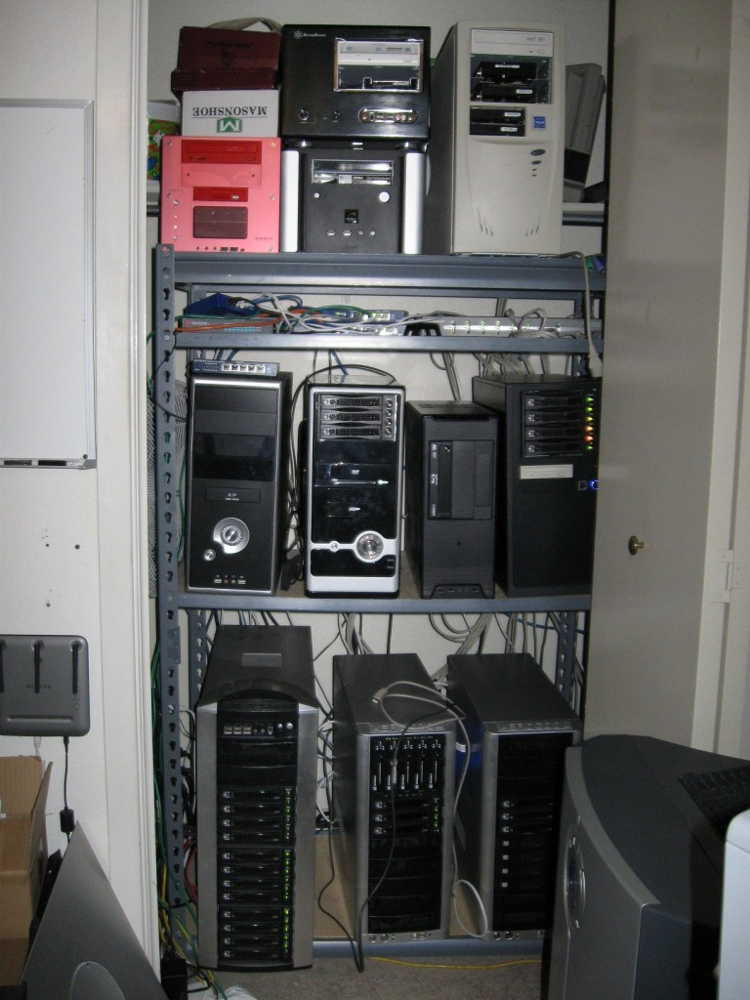
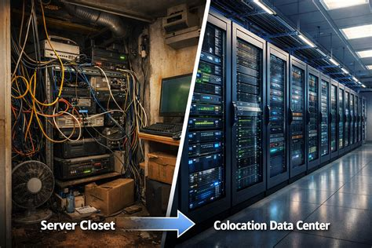
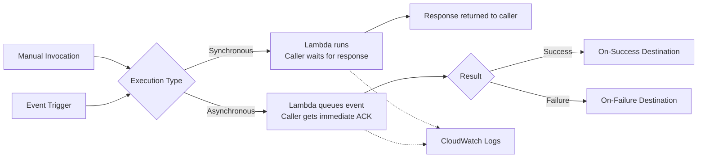

# Lambda?

- What are they?
- What are they good for?
- What are they not good for?
- Deploying Hello World

# First

Some history

# Servers

{ height=400px }

## You

- Empty the closet
- Buy & build servers
- Get fast internet
- Connect all servers
- Install debian w/ apache, etc

## Problems?

- Trip on a power cable?
- Tractor cut the fiber?
- Toilet leaks onto your machines?
- rm -rf /? Backups?


All your problems.

Total control = total responsibility

# Rack Space

{ height=400px }

## Them

- Give you X square feet
- Supply electricity
- Keep the doors locked

They also introduce you to the neighbors for "peering"

## You

- Pay your rent
- Buy and ship servers
- Install your racks
- Connect servers and internet
- Keep servers up to date

Still do almost everything, without leaking toilets.

# Managed Services

```
Nothing <----> "White Gloves" <----> Fully Managed
```

# Virtualization

## VMware / KVM / Xen / etc

- Lets you divide hardware into multiple VMs
- Increased efficiency with bin-packing
- Scripting enables quick experimentation
- Migrating machines helps w/ resiliency

Hardware & Software are decoupled.

> One team can manage hardware. Others can manage their VMs.

## Them

- Buy and manage hardware
- Keep the base network up
- Keep the control plane up
- Offer up to date base images
- Maybe backups, maybe DR?

## You

- Install your systems in VMs
- Monitor your own stuff
- ...

# AWS

They figured out they could rent infrastructure.

> Elastic Compute Cloud (2006)


Started by the hour. Now it's by the second (60s minimum).

## Auto-Scaling

Another big AWS innovation.

Based on rules, add and remove machines to a compute pool.

Rules can be based on time, resource usage, or other monitoring telemetry.

## Isolation

You get a full OS, isolated VM, w/ CPU & RAM allocations.

Noisy neighbors mostly isolated.

## The Cost

- Minimum 0.5GB
  - (1.7GB minimum in the beginning)
- Minimum 1 vCPU

Needs to run all the time to respond to synchronous requests.

## Granularity

{ height=500px }

## Delays

- Auto-scaling rules can take a couple minutes to kick in
- Instances can take a couple minutes to be ready

Easily up to 5 minutes to respond to a big bump in traffic. It could be too late.

## Them

- data centers
- hardware
- hypervisor
- network
- ...

## You

- OS patching
- Scaling rules
- Capacity planning
- Machine images
- Everything above the VM

[Shared responsibility model](https://aws.amazon.com/compliance/shared-responsibility-model/)

# chroot, LXC, and Docker

Largely addresses scaling granularity, and high start-up times.

Let's conveniently ignore these.

(dated 1979, 2008, and 2013, respectively)

## TL;DR

- Shared kernel
- Isolated file system
- potential network and process isolation

# AWS Lambda

TL;DR Independently deployable functions

drop your code into a known minimal run-time

2014

## Runtimes

- Nodejs
- Python
- C#
- Java
- Ruby
- Golang*

and point it to a function in your codebase

# Benefits

## Smaller Resource Allocations

- 128MB RAM minimum
- CPU is proportional

## Pay per execution time

> $RUNTIME_SECONDS * $RAM_ALLOCATION + (0.20$ / 1000000)

Makes it really cheap! (*)

## Start-up times

Typically under a second!

## Isolation

It's still a VM, despite responding really quickly.

[Firecracker VM](https://en.wikipedia.org/wiki/Firecracker_(software))

## Integrations w/ AWS services

- S3
- SNS
- SQS
- EventBridge
- Kafka
- DynamoDB
- API Gateway
- etc

# What they're good for

- Very bursty services
- Event driven architectures
- Simple isolated functionalities

# What they're not great at

- Predictable & sustained loads
- Complex/unsupported run-times
- Software with high start-up times

# Responsibilities

## Them

- Stable and patched software run-time
- Stable and patched servers
- Event Plumbing
- Management API

## You

- Your code
- Your dependencies
- Concurrency rules
- Permissions & Configuration

# A Chart



## Invocation

API based invocation

- Synchronous: wait until you get the result
- Asynchronous: immediately get an Id

## Event Triggers

Event based invocation

- SQS, S3, etc

## Logs go to Cloudwatch

Includes basic telemetry (duration and memory usage)

## Optional "destination"

trigger something else, for async invocations

SQS, Lambda, SNS, EventBridge, ...

Failure, Success, or both

# Hello World

Let's deploy something
